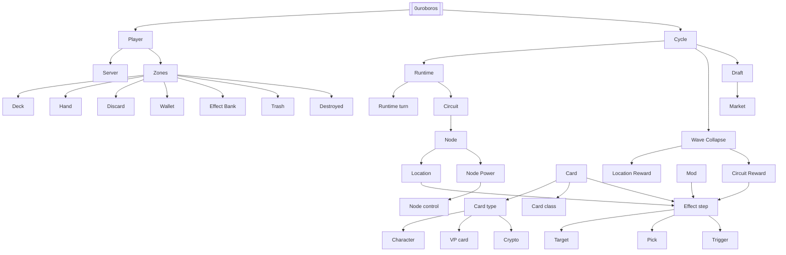

# 0uroboros Ontology

The map of everything that exists in 0uroboros and how the pieces relate. Each concept is one note; its properties say what it **is a** kind of (`is_a`), what it is **part of** (`part_of`) and what it touches (`related`).

When notes disagree with older design docs, the code and [[Glossary]] win: they follow the latest user decisions.

## Overview

## Branches

### Structure of play
- [[0uroboros]] — the game itself
- [[Player]]
- [[Cycle]] → [[Runtime]] → [[Runtime turn]] → [[Reveal]] / [[Reveal priority]]
- [[Wave Collapse]]
- [[Draft]]
- [[Game end]]

### Board
- [[Circuit]] — the five Nodes of a Cycle
- [[Node]] and the [[Location]] dealt onto it
- [[Node Power]] and [[Node control]]
- [[Server]]

### Cards
- [[Card]]
- [[Card type]]: [[Character]], [[VP card]], [[Crypto card]]
- [[Card class]] and [[Card pool]]
- [[Card Power]]
- [[Duration]]
- [[Mod]], [[Morph]], [[Generated card]]
- [[Starting deck]]

### Zones
- [[Zone]]: [[Deck]], [[Hand]], [[Discard]], [[Wallet]], [[Effect Bank]], [[Trash]], [[Destroyed]]

### Resources and rewards
- [[Action]], [[Crypto]], [[Victory Points]]
- [[Market]]
- [[Location Reward]], [[Circuit Reward]]

### Effects
- [[Effect step]] — the one recipe shape used by cards, Locations, rewards and mods
- [[Trigger]], [[Scope]], [[Target]], [[Who]], [[Pick]]
- Effect families: [[Resource effects]], [[Server effects]], [[Card effects]], [[Deck effects]], [[Node Power effects]], [[Mod effects]], [[Flow effects]]

### Reference
- [[Glossary]] — terms, aliases and retired words
- [[Card Text Style Guide]]
- Indexes: [[Cards index]], [[Locations index]], [[Circuit Rewards index]], [[Starting decks and mods index]]

## Property schema

| Property | Meaning |
| --- | --- |
| `kind` | `hub`, `concept`, `index` or `guide` |
| `category` | Branch: structure, board, cards, zones, resources, effects, reference |
| `is_a` | The broader concept this is a kind of |
| `part_of` | The whole this belongs to |
| `related` | Other concepts it acts on or depends on |
| `code` | Where it lives in `0uroboros_v2` |
