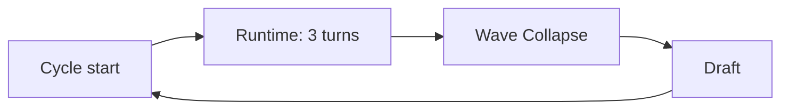

# Cycle

The main unit of play and one of the two time scales (the other is the [[Runtime turn]]). A game has up to 16 Cycles.

## Sequence

**Cycle start:** [[Wallet]] resets to 0 → [[Location|Locations]] are shuffled onto the [[Node|Nodes]] → start-of-Cycle effects → each player draws 5.

**End of Cycle:** cards left in [[Hand]] go to [[Discard]]. [[Action|Actions]] do not carry into the next Cycle.

## Parts
1. [[Runtime]] — three [[Runtime turn|Runtime turns]] of deploying and revealing
2. [[Wave Collapse]] — every Node resolves
3. [[Draft]] — buy cards with [[Crypto]]

## As a time scale
[[Duration]] cards count either Runtime turns or Cycles. "In 2 Cycles", "every Cycle", "Lasts 2 Cycles".
