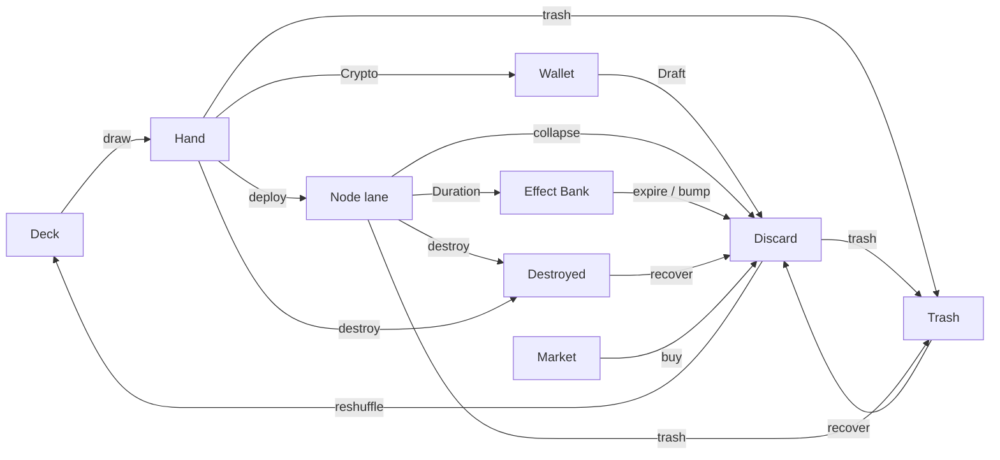

# Zone

A place a [[Card]] can be. Every copy is in exactly one zone.

| Zone | Owner | Notes |
| --- | --- | --- |
| [[Deck]] | Player | Draw pile; top and bottom are targetable |
| [[Hand]] | Player | Drawn cards |
| [[Discard]] | Player | Reshuffled into the deck when it runs out |
| [[Wallet]] | Player | Crypto cards waiting for the Draft |
| Node lane | Player, per [[Node]] | Deployed cards, max 4 |
| [[Effect Bank]] | Player | 4 slots for Duration cards |
| [[Trash]] | Shared | Recoverable |
| [[Destroyed]] | Player | Removed from play |

In effect targets, "board" = any revealed card, "thisNode" = revealed cards here, "collection" = deck, then Discard, then hand.
