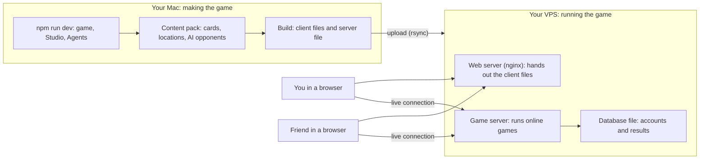
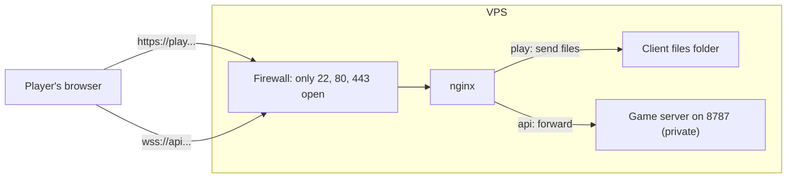

# 0uroboros: how it fits together, and putting it online

This guide is written for someone who builds apps but hasn't run a server before. It explains what each piece is, why
it's there, and what each step makes possible, then gives exact commands to copy.

**What you'll end up with:** the game running on your own Hostinger VPS, so that you and your friends can open a web
address and play each other online. Later, the desktop and iPad apps connect to the same server.

**How to use it:**

- Read **Part 1** once. It's the mental model; everything later refers back to it.
- **Part 2** is reference: the pieces of the project and how to launch each one.
- **Part 3** creates the VPS at Hostinger.
- Then pick one path:
  - **Part 4 (quick playtest):** play with a friend using just the VPS's IP address. No domain, no HTTPS, no
    accounts. About an hour.
  - **Part 5 (full setup):** your own web address, HTTPS, e-mail sign-in and ratings. Builds on Part 4, so nothing in
    Part 4 is wasted.
- **Part 6** is what you repeat for every release, **Part 7** is looking after the server, and **Part 8** is what to do
  when something doesn't work.

A glossary of server words is at the end.

---

## Part 1: The ideas, in plain language

### Two worlds: where you make the game, and where people play it

Everything you use to *make* the game stays on your Mac:

- the dev server (`npm run dev`) with the game, the Content Studio (`/author`) and the AI agents page (`/agents`);
- the agents' notebooks, test games and logs;
- your source code.

What players use is two **builds**: finished, packaged copies made from your source.

- **The client**: the game itself, as files a browser downloads (HTML, JavaScript, art, video). The desktop and iPad
  apps are the same client in a wrapper.
- **The game server**: a program that runs all the time on the VPS. Every online game goes through it.

You build both on your Mac and upload the results. The VPS never sees your source code, the Studio or the agents. This
is standard practice: the server only runs finished builds, and nothing private or half-finished can leak.



### Why a game server is needed at all

Two browsers can't talk to each other directly. The game server sits in the middle:

- It's **the referee**: it deals the cards, checks every move, and decides results, so nobody can cheat by editing
  their own browser.
- It **keeps secrets**: your hand and your unrevealed placements never reach your opponent's browser.
- It runs **timers, the lobby, table codes, quick match, AI tables, sign-in and ratings**.

Without it the web client still works, but only for games against the AI on that one device.

Players keep an open, two-way connection to the server for the whole game, called a **WebSocket**. Moves travel over
it instantly in both directions. Addresses for it start with `ws://` (unencrypted) or `wss://` (encrypted), the way web
addresses start with `http://` or `https://`.

### What a VPS is

A **VPS** (virtual private server) is a computer in a data centre that you rent and control completely. It runs Linux
(Ubuntu here), it's always on, and it has its own public **IP address** (like `123.45.67.89`) that anyone on the
internet can reach.

It has no screen or mouse. You control it by typing commands into a remote terminal over **SSH**, which is just a
secure way to open a Terminal on another machine. You log in as **root**, the all-powerful admin user.

"Plain OS" means you get bare Ubuntu and install only what you need. That's why the guide picks it over Hostinger's
ready-made templates: you know exactly what's on the machine and why.

### Ports and the firewall

One IP address can run many services. Each listens on a numbered **port**, like flats in one building:

| Port | Used for |
| --- | --- |
| 22 | SSH (you logging in) |
| 80 | Ordinary web traffic (`http://`) |
| 443 | Encrypted web traffic (`https://` and `wss://`) |
| 8787 | The game server itself |

The **firewall** (`ufw`) decides which ports the outside world can reach. Everything else stays shut, which is the
single biggest safety measure on a server. In the quick playtest you open 8787 directly. In the full setup it closes
again and players reach the game server through 443.

### Domains and DNS

A **domain** (like `yourdomain.com`) is a human-friendly name. **DNS** is the internet's address book that turns a name
into an IP address. You add records called **A records**: "`play.yourdomain.com` lives at `123.45.67.89`".

You need a domain for HTTPS (certificates are issued to names, not IP addresses). That's why the quick playtest uses
the IP address and plain `http://`, and the full setup adds a domain.

The full setup uses two names on the same VPS:

- `play.yourdomain.com` for the client (the game players open);
- `api.yourdomain.com` for the game server.

### nginx: the front door

**nginx** (say "engine-x") is the web server. It does two jobs:

1. **Hands out files.** When someone opens `play.yourdomain.com`, nginx sends them the client files from a folder.
2. **Forwards connections** (a "reverse proxy"). When someone connects to `api.yourdomain.com`, nginx passes the
   connection to the game server on port 8787, which stays hidden from the internet.

Putting nginx in front is standard because it handles the fiddly, security-sensitive work (HTTPS, caching, large file
downloads, slow connections) so the game server only deals with games.



### HTTPS and certificates

**HTTPS** encrypts traffic so nobody between the player and the server can read or change it. It also proves to the
browser that the site really is yours, using a **certificate**. **Let's Encrypt** gives certificates away free, and a
tool called **certbot** fetches and renews them automatically.

What HTTPS enables here: e-mail sign-in links that are safe to click, players trusting the site (no "Not secure"
warning), and encrypted game connections (`wss://`).

### Keeping the game server running: systemd

If you start a program by hand in a terminal, it stops when you log out or the machine restarts. **systemd** is
Ubuntu's service manager: you describe the game server once in a small "unit" file, and systemd starts it at boot,
restarts it if it crashes, and collects its logs. You control it with `systemctl` (start, stop, restart, status) and
read the logs with `journalctl`.

### Settings: environment variables

The game server reads its settings from **environment variables**: named values like `PORT=8787` handed to a program
when it starts. You keep them in one settings file on the VPS (`/etc/0uroboros/server.env`) that systemd reads. Secrets
such as API keys live only there, never in your code or git.

### Uploading builds: rsync

**rsync** copies a folder from your Mac to the VPS over SSH, and only sends what changed, so updates are quick. With
`--delete` it also removes files on the VPS that no longer exist in the new build, so the server copy exactly matches
what you built.

### The database

The game already has a database: **SQLite**. It's built into Node.js and keeps everything in one file
(`/var/lib/0uroboros/ouroboros.sqlite`): accounts and sign-in sessions, ratings, finished games and replays, and the
content packs it has served. The game server creates the file on first start. There's no separate database program to
install, secure or keep running, and backing it up means copying one file.

SQLite is the right choice while the game runs as one server process on one machine, which it must anyway (games live
in that process's memory). If you ever need several game servers side by side, you'd move to a database server such as
Postgres; the storage code is kept separate so that's a contained change.

Not a database: Obsidian (your notes), MongoDB (installed by Hostinger's MERN template, which this game doesn't use).

---

## Part 2: Architecture reference

### The pieces

| Piece | What it is | Where it runs | Ships to players? |
| --- | --- | --- | --- |
| Dev server | The game, Content Studio and Agents pages, plus local-only APIs (`/api/content`, `/api/agents`, `/api/ai`, `/api/game-log`) | Your Mac, port 5173 | No |
| Content Studio | Authoring cards, locations, decks and opponents (`/author`) | Inside the dev server | No |
| Agents page | Strat-G, T-5, DV-8, VP-Dog and Eco-Strat: league games, mentoring, notebooks, **Publish to the pack** (`/agents`) | Inside the dev server; needs `OPENAI_API_KEY` in `.env` to learn with a model | No |
| Game server | Online games: rooms, seats, timers, AI tables, quick match, ratings, e-mail sign-in, content packs, crash reports | VPS, port 8787 | Yes (as a service) |
| Web client | The game as static files, plus the download page | VPS, served by nginx | Yes |
| Desktop app | The client in Electron (website download or Steam) | Players' computers | Yes |
| iPad app | The client in Capacitor | Players' iPads | Yes |

### Code layout

| Folder | Contents | Ends up in |
| --- | --- | --- |
| `packages/engine` | Game rules, the runtime, and the AI "brain" (`ai/strategy.ts`, `ai/opponents.ts`) | Every build |
| `packages/content` | The published content pack, its hash, and the list of shipped art | Server and client |
| `packages/protocol` | The messages client and server exchange | Server and client |
| `packages/server` | The game server | Server build |
| `src/` | The client UI. `src/authoring/` and the agents files are studio-only | Client (minus studio parts) and studio |
| `server/` | The dev server's local APIs and the AI agents | Dev server only |
| `content/authored-content.json` | The content pack: cards, locations, decks, published AI opponents | Bundled into server and client |
| `desktop/`, `ipad/` | The Electron and Capacitor wrappers | Desktop and iPad builds |
| `site/` | The download page and caching rules, merged into the web build | Web build |

`npm run lint:boundaries` enforces these borders, so studio and agent code can't end up in a player build, and
`build:client` double-checks the finished files.

### How the AI opponents reach players

- The **brain** is code in the engine; changing it needs new client and server builds.
- Each **opponent** (Strat-G, T-5, DV-8, VP-Dog) is a small profile of numbers stored in the content pack. The agents
  learn on your Mac; when one is ready, press **Publish … to the pack** on `/agents` (Agents tab).
- Online tables, including AI tables the server hosts, use the server's pack. A client with an older pack downloads the
  new one automatically, so **re-tuning an opponent only needs a server update** for online play.
- Games against the AI that run inside the client without the server use the pack bundled in the client, so they get
  the new opponent with the next client build.

### What to rebuild when

| You changed | Update the server | Update the client |
| --- | --- | --- |
| Published an agent, or edited cards and locations in the Studio | Yes | Optional: online play updates without it; local AI games need it |
| Game rules or AI code (`packages/engine`) | Yes | Yes |
| Client UI only (`src/`) | No | Yes |
| Server-only code (`packages/server`) | Yes | No |

Old and new versions stay compatible: the server keeps the current and previous content pack, so players on an older
client keep playing through an update.

### Launch commands (on your Mac)

Run these from the `0uroboros_v2` folder. In zsh, don't put `# comments` after a command on the same line: zsh hands
them to the command as extra arguments.

| What | Command | Where it appears |
| --- | --- | --- |
| Dev server (game, Studio, Agents) | `npm run dev` | http://127.0.0.1:5173/ , `/author`, `/agents` |
| Local game server (builds, then runs with a database in `.data/`) | `npm run server:dev` | ws://127.0.0.1:8787 |
| Run an already-built server | `npm run server:start` | ws://127.0.0.1:8787 |
| Unit tests | `npm test` | |
| Two-browser online test | `npm run test:online` | |
| Refresh the list of shipped art (before any client build) | `npm run assets:manifest` | |
| Build the game server | `npm run server:build` | `dist/server/main.mjs` |
| Build the website (client plus download page) | `npm run build:site` | `dist/site` |
| Build the client only | `npm run build:client` | `dist/client` |
| Build the studio (local use only) | `npm run build` | `dist` |
| Desktop app (development) | `cd desktop && npm start` | |
| Desktop installers | `cd desktop && npm run dist` (or `npm run dist:steam`) | `desktop/release` |
| iPad app | `cd ipad && npm run stage && npm run sync && npm run open` | Opens Xcode |

To try online play entirely on your Mac, run `npm run server:dev` in one terminal and `npm run dev` in another. The
local client looks for the game server on port 8787 of the same machine.

### Game server settings

All read by `packages/server/src/main.ts` when the server starts.

| Setting | What it does | Quick playtest | Full setup |
| --- | --- | --- | --- |
| `PORT` | Port the server listens on | `8787` | `8787` |
| `HOST` | Who may connect directly. `0.0.0.0` means anyone; `127.0.0.1` means only programs on the VPS (nginx) | `0.0.0.0` | `127.0.0.1` |
| `OUROBOROS_DB` | Database file. Unset, everything is lost on restart | `/var/lib/0uroboros/ouroboros.sqlite` | same |
| `OUROBOROS_TRUST_PROXY` | Whether to read the player's address from headers nginx adds. Used for per-player limits | `off` (players connect directly) | leave unset (on) |
| `OUROBOROS_PUBLIC_URL` | The server's public address; sign-in links point here. **Setting it turns sign-in on** | leave unset (everyone is a guest) | `https://api.yourdomain.com` |
| `OUROBOROS_WEB_ORIGIN` | The client's address: allowed to call the server, and where sign-in returns to | leave unset | `https://play.yourdomain.com` |
| `RESEND_API_KEY`, `MAIL_FROM` | Sends sign-in e-mails through Resend. Unset, links only appear in the server log | leave unset | from resend.com |
| `OUROBOROS_ADMIN_TOKEN` | Password that lets your Mac's Eco-Strat pull finished online games | leave unset | a long random string |
| `OUROBOROS_MAX_ROOMS` | Tables alive at once | default 500 | `500` |
| `OUROBOROS_RELEASE` | Version label on error reports | optional | set on each release |
| `SENTRY_DSN` | Optional error-reporting service | no | optional |
| `STEAM_WEB_API_KEY`, `STEAM_APP_ID`, `APPLE_AUDIENCES` | Steam and Apple sign-in for the desktop and iPad apps | no | later |
| `OUROBOROS_PACK_URL` | A separate download service for content packs | no | leave unset |

The client has one build setting, `VITE_GAME_SERVER_URL`: the game server address baked into the web, desktop and iPad
builds. Leave it unset for the quick playtest (the client then looks on port 8787 of whatever address the page came
from). For the full setup it's `wss://api.yourdomain.com`.

### Facts about the running server

- **Exactly one game server process.** Tables live in its memory; two copies would split players between two lobbies.
- **Restarting ends games in progress** (tables are in memory). Accounts, ratings and finished games are in the
  database and survive. Update when nobody is mid-game.
- **The content pack is built into the server.** A new pack means rebuilding and restarting the server.
- **Health check:** `/healthz` answers with the protocol version and how many tables and players are connected.
- **Logs:** one line of JSON per event. Under systemd: `journalctl -u 0uroboros`.

### Does it matter that this is a VPS rather than Cloudflare or Fly?

No. The earlier plan named Fly.io for the server and Cloudflare Pages for the website; one VPS with nginx does both
jobs. What's different:

- `site/_headers` (caching rules) is only read by Cloudflare and Netlify. The nginx config in Part 5 contains the same
  rules.
- `deploy/fly.toml`, `deploy/Dockerfile`, and the GitHub workflows `deploy-server.yml` and `deploy-site.yml` are for
  Fly and Cloudflare. Without their secrets they deploy nothing (their runs just fail on GitHub). Delete or adapt them
  later.
- There's no CDN (a worldwide network of copies that makes downloads faster far away). Players download art and video
  straight from the VPS, which is fine for playtests. You can put Cloudflare's free service in front of the domain
  later without changing the game.

---

## Part 3: Creating the VPS at Hostinger

Hostinger asks a few questions when you set the VPS up. Recommended answers:

| Screen | Choose | Why |
| --- | --- | --- |
| Plan | Any KVM plan (KVM 1 or KVM 2 is plenty to start) | The game server is light; most of the load is players downloading art |
| Location | The data centre nearest you and your friends | Shorter distance means snappier moves |
| What to install | **Plain OS › Ubuntu › 24.04** (clear the search box first; searching "node" hides Plain OS) | A clean, long-term-supported Linux with nothing extra. Hostinger's Node templates fix the Node.js version and bring their own web server or a database the game doesn't use |
| Control panel | None (that's what Plain OS means) | Panels are for managing many websites; you'll use a few commands instead |
| Monarx malware scanner | Optional (free) | Aimed at PHP and WordPress sites; harmless to tick. The firewall and updates are your real protection |
| Daily auto-backups | Skip for now (paid) | Only the database file is irreplaceable, and Part 7 backs it up for free. Revisit once real players have accounts |
| Docker manager | Skip | The game server runs directly on Node; there are no containers |
| Root password | A long, unique password, saved in your password manager | It's the master key to the server |
| SSH key | Optional now; Part 3 step 2 sets one up | Lets your Mac log in without the password |

When it finishes, the VPS overview in hPanel shows the **IP address**. Note it down.

### Step 1: Log in for the first time

**What:** open a remote terminal on the VPS. **Why:** every setup step is typed here.

On your Mac, open Terminal (or Cursor's terminal) and run, with your IP:

```bash
ssh root@123.45.67.89
```

The first time, it asks whether you trust the server ("Are you sure you want to continue connecting?"). Type `yes`.
Then type the root password (nothing appears as you type; that's normal).

You're in when the prompt changes to something like `root@srv123:~#`. Type `exit` to leave. hPanel also has a
**Browser terminal** button that does the same thing in a web page.

### Step 2: Log in with a key instead of a password

**What:** give the VPS your Mac's public key. **Why:** you won't type the password on every upload, and keys are much
harder to break than passwords. **Enables:** the one-line uploads in Part 6.

On your Mac:

```bash
ls ~/.ssh/id_ed25519.pub || ssh-keygen -t ed25519
ssh-copy-id root@123.45.67.89
```

The first line makes a key only if you don't have one (press Enter to accept the defaults). The second asks for the
root password one last time.

**Check:** `ssh root@123.45.67.89` now logs in without asking for the password.

### Step 3: Make a shortcut for the address

To avoid retyping the IP, set it once in each Terminal window you use for deploying:

```bash
export VPS=root@123.45.67.89
```

The rest of the guide writes `$VPS` wherever it means "your server". Commands that start with `ssh $VPS` or
`rsync … $VPS:` run on your Mac; commands in blocks marked **on the VPS** run after you've logged in with `ssh $VPS`.

---

## Part 4: Quick playtest with a friend (IP address only)

**What you get:** you and a friend open `http://123.45.67.89` and play each other online. Everyone is a guest: no
sign-in, no ratings. Connections aren't encrypted, which is fine for a friendly test.

**What it skips, on purpose:** the domain, HTTPS and e-mail. Part 5 adds them on top of this.

### Step 1: Install the basics (on the VPS)

```bash
apt update && apt upgrade -y
apt install -y nginx ufw rsync sqlite3
```

**What:** `apt` is Ubuntu's app store for servers. The first line updates the system; the second installs nginx (the
web server), ufw (the firewall), rsync (for uploads) and sqlite3 (to inspect and back up the database). If it asks
about restarting services, accept the defaults.

### Step 2: Turn on the firewall (on the VPS)

```bash
ufw allow OpenSSH
ufw allow 80
ufw allow 8787
ufw enable
```

**What:** allow SSH (so you don't lock yourself out), ordinary web traffic, and the game server's port; block
everything else. Type `y` when asked.

**Check:** `ufw status` lists those three.

### Step 3: Install Node.js 24 (on the VPS)

```bash
curl -fsSL https://deb.nodesource.com/setup_24.x | bash -
apt install -y nodejs
node --version
```

**What:** Node.js is what runs the game server. **Why this way:** Ubuntu's own copy is too old; the game server needs
Node 22.5 or newer for its built-in database. **Check:** `node --version` prints `v24…`.

### Step 4: Create the server's user and folders (on the VPS)

```bash
useradd --system --create-home --shell /usr/sbin/nologin ouroboros
mkdir -p /opt/0uroboros/server /var/lib/0uroboros /var/www/0uroboros/site /etc/0uroboros
chown -R ouroboros:ouroboros /opt/0uroboros /var/lib/0uroboros
```

**What:** a dedicated user called `ouroboros` that runs the game server, and folders for each kind of thing:

| Folder | Holds |
| --- | --- |
| `/opt/0uroboros/server` | The game server program |
| `/var/lib/0uroboros` | The database file |
| `/var/www/0uroboros/site` | The client files nginx hands out |
| `/etc/0uroboros` | The server's settings file |

**Why a separate user:** the game server faces the internet. Running it as a limited user means that even if someone
found a flaw in it, they couldn't touch the rest of the machine. These folder locations are Linux conventions, so
anyone who helps you later will know where to look.

### Step 5: Install the game server's two libraries (on the VPS)

```bash
cd /opt/0uroboros/server
sudo -u ouroboros npm init -y >/dev/null
sudo -u ouroboros npm install --omit=dev ws@8.22.0 zod@4.6.5
```

**What:** the server build is a single file that needs two small libraries beside it: `ws` (WebSocket connections) and
`zod` (checking messages). The versions match the project's `package-lock.json`. If you update either in the project,
repeat this with the new versions.

### Step 6: Write the settings file (on the VPS)

```bash
nano /etc/0uroboros/server.env
```

`nano` is a simple text editor. Paste this, then save with **Ctrl+O, Enter** and quit with **Ctrl+X**:

```ini
PORT=8787
HOST=0.0.0.0
OUROBOROS_DB=/var/lib/0uroboros/ouroboros.sqlite
OUROBOROS_TRUST_PROXY=off
```

Then make it readable only by admins:

```bash
chmod 600 /etc/0uroboros/server.env
```

**What these mean:** listen on port 8787, accept connections from anywhere, keep data in the database file, and take
each player's address from their own connection (there's no nginx in front of the game server yet). Leaving out
`OUROBOROS_PUBLIC_URL` keeps sign-in off, so everyone plays as a guest.

### Step 7: Register the game server with systemd (on the VPS)

```bash
nano /etc/systemd/system/0uroboros.service
```

Paste, save and quit:

```ini
[Unit]
Description=0uroboros game server
After=network.target

[Service]
User=ouroboros
WorkingDirectory=/opt/0uroboros/server
EnvironmentFile=/etc/0uroboros/server.env
ExecStart=/usr/bin/node dist/server/main.mjs
Restart=always
RestartSec=3

[Install]
WantedBy=multi-user.target
```

```bash
systemctl daemon-reload
systemctl enable 0uroboros
```

**What:** "run `node dist/server/main.mjs` as the `ouroboros` user with these settings, restart it 3 seconds after any
crash, and start it at boot." `daemon-reload` tells systemd about the new file; `enable` turns on start-at-boot. It
won't start yet because the program isn't uploaded.

### Step 8: Point nginx at the client files (on the VPS)

```bash
sed -i 's#root /var/www/html;#root /var/www/0uroboros/site;#' /etc/nginx/sites-available/default
nginx -t && systemctl reload nginx
```

**What:** nginx's default site serves a "Welcome to nginx" page from `/var/www/html`; this points it at the game's
folder instead. `nginx -t` checks the config for mistakes before `reload` applies it.

### Step 9: Build and upload (on your Mac)

From the `0uroboros_v2` folder (quotes needed because the path has spaces):

```bash
cd "/Users/t-minus/Dropbox/00_AI Projects/0uroboros_ProjectFolder/0uroboros_v2"
export VPS=root@123.45.67.89

npm run assets:manifest
npm run server:build
npm run build:site

rsync -av --delete dist/server/ $VPS:/opt/0uroboros/server/dist/server/
rsync -av --delete dist/site/ $VPS:/var/www/0uroboros/site/
ssh $VPS "chown -R ouroboros:ouroboros /opt/0uroboros/server && systemctl restart 0uroboros"
```

**What each line does:**

- `assets:manifest` refreshes the list of art the client ships; the client build refuses to run if it's stale.
- `server:build` makes the game server file, `dist/server/main.mjs`, with the content pack inside.
- `build:site` makes the client plus download page in `dist/site`. It warns that `VITE_GAME_SERVER_URL` is unset;
  that's expected here, and makes the client look for the game server on port 8787 of the address the page came from.
- The two `rsync` lines upload both builds (the first upload of the client is about 70 MB, so give it a minute).
- The last line hands the files to the `ouroboros` user and starts the game server.

### Step 10: Check it, then play

From your Mac:

```bash
curl http://123.45.67.89:8787/healthz
```

It should print something like `{"ok":true,"protocol":1,"rooms":0,...}`. Then:

1. Open `http://123.45.67.89` in your browser. You should see the game's start screen.
2. Create a table and send your friend the table code.
3. Your friend opens the same address, joins with the code, and you play.

If anything's off, see Part 8.

---

## Part 5: Full setup (domain, HTTPS, sign-in)

**What you get:** `https://play.yourdomain.com` for players, an encrypted game connection, e-mail sign-in with
accounts and ratings, and the game server hidden behind nginx.

**Before you start:** you need a domain. If you bought it at Hostinger, its DNS is in hPanel. If you bought it
elsewhere, add the records wherever that domain's DNS is managed.

If you haven't done Part 4, do its steps 1 to 7 first (skip step 2's `ufw allow 8787` and step 8), and use the Part 5
settings file below instead of Part 4's.

### Step 1: Point two names at the VPS (in hPanel)

**What:** add two A records. **Why:** so `play.yourdomain.com` and `api.yourdomain.com` lead to your VPS.

In hPanel › Domains › your domain › DNS / Nameservers › DNS records, add:

| Type | Name | Points to | TTL |
| --- | --- | --- | --- |
| A | `play` | your VPS IP | default |
| A | `api` | your VPS IP | default |

**Check (on your Mac):** `ping -c 3 play.yourdomain.com` shows your VPS IP. New records usually work within minutes but
can take up to an hour.

### Step 2: Set up e-mail sending (optional, at resend.com)

**What:** sign-in works by e-mailing a one-time link. The game server sends those through **Resend**, an e-mail
service. **Why:** sending mail directly from a VPS usually lands in spam; services like Resend are trusted by inboxes.

1. Create a free account at resend.com.
2. Add your domain there. Resend shows a few DNS records; add them in hPanel the same way as step 1.
3. Once Resend shows the domain as verified, create an API key and keep it for step 3.

**Skipping it is fine for now:** sign-in links then appear in the server log instead of being mailed (Part 8 shows
how to find them), which works for you and a friend you can message the link to.

### Step 3: Update the settings file (on the VPS)

```bash
nano /etc/0uroboros/server.env
```

Replace everything with:

```ini
PORT=8787
HOST=127.0.0.1
OUROBOROS_DB=/var/lib/0uroboros/ouroboros.sqlite
OUROBOROS_PUBLIC_URL=https://api.yourdomain.com
OUROBOROS_WEB_ORIGIN=https://play.yourdomain.com
OUROBOROS_MAX_ROOMS=500
OUROBOROS_ADMIN_TOKEN=paste-a-long-random-string-here
RESEND_API_KEY=
MAIL_FROM=0uroboros <play@yourdomain.com>
```

Make the admin token with `openssl rand -hex 32` and paste the result. Paste your Resend key after `RESEND_API_KEY=`, or
leave it empty.

**What changed and why:**

- `HOST=127.0.0.1`: the game server now only accepts connections from nginx on the same machine. The internet can no
  longer reach port 8787 directly.
- `OUROBOROS_TRUST_PROXY=off` is gone: the server now reads each player's real address from the header nginx adds.
- `OUROBOROS_PUBLIC_URL` and `OUROBOROS_WEB_ORIGIN` turn sign-in on and tell the server where it and the client live.
- `OUROBOROS_ADMIN_TOKEN` lets your Mac's Eco-Strat read finished online games (Part 6).

### Step 4: Configure nginx for both names (on the VPS)

First, a small shared setting that lets WebSocket connections pass through nginx:

```bash
nano /etc/nginx/conf.d/websocket-upgrade.conf
```

```nginx
map $http_upgrade $connection_upgrade {
  default upgrade;
  ''      close;
}
```

Then the site itself:

```bash
nano /etc/nginx/sites-available/0uroboros
```

```nginx
# The client: play.yourdomain.com
server {
  listen 80;
  server_name play.yourdomain.com;
  root /var/www/0uroboros/site;
  index index.html;

  add_header X-Frame-Options DENY always;
  add_header X-Content-Type-Options nosniff always;
  add_header Referrer-Policy strict-origin-when-cross-origin always;

  gzip on;
  gzip_types text/css application/javascript application/json image/svg+xml;

  # Art keeps the same file names between builds, so browsers may reuse it for a day
  location /assets/ {
    add_header Cache-Control "public, max-age=86400, stale-while-revalidate=604800" always;
    add_header X-Content-Type-Options nosniff always;
    try_files $uri =404;
  }
  location /download/ {
    add_header Cache-Control "public, max-age=3600" always;
    try_files $uri $uri/ =404;
  }
  # Always re-check these, so players get a new build as soon as it's uploaded
  location = /index.html { add_header Cache-Control "no-cache" always; }
  location = /version.json { add_header Cache-Control "no-cache" always; }

  location / {
    try_files $uri $uri/ /index.html;
  }
}

# The game server: api.yourdomain.com
server {
  listen 80;
  server_name api.yourdomain.com;

  location / {
    proxy_pass http://127.0.0.1:8787;
    proxy_http_version 1.1;
    proxy_set_header Upgrade $http_upgrade;
    proxy_set_header Connection $connection_upgrade;
    proxy_set_header Host $host;
    # The server limits connections per player address. Set the real address, and blank the other
    # address headers it understands, so nobody can pretend to be someone else.
    proxy_set_header X-Forwarded-For $remote_addr;
    proxy_set_header Fly-Client-IP "";
    proxy_set_header CF-Connecting-IP "";
    proxy_set_header X-Forwarded-Proto $scheme;
    # A game connection stays open for a long time
    proxy_read_timeout 1h;
    proxy_send_timeout 1h;
    client_max_body_size 1m;
  }
}
```

Switch from the default site to this one and check it:

```bash
ln -s /etc/nginx/sites-available/0uroboros /etc/nginx/sites-enabled/
rm -f /etc/nginx/sites-enabled/default
nginx -t && systemctl reload nginx
```

**What it does:** the first block hands out the client files with sensible caching (art is cached for a day; the page
itself is always re-checked so updates show up). The second forwards everything for `api.` to the game server,
including the WebSocket upgrade. `rm … default` retires Part 4's IP-address site.

### Step 5: Turn on HTTPS (on the VPS)

```bash
apt install -y certbot python3-certbot-nginx
ufw allow 'Nginx Full'
certbot --nginx -d play.yourdomain.com -d api.yourdomain.com
```

Certbot asks for an e-mail (for expiry warnings) and to accept the terms. When it asks whether to redirect HTTP to
HTTPS, choose redirect.

**What:** opens port 443, gets free Let's Encrypt certificates for both names, adds the HTTPS settings to the nginx
config, and sets up automatic renewal (certificates last 90 days and renew themselves).

**Check:** `certbot renew --dry-run` finishes without errors.

### Step 6: Close the direct game port (on the VPS)

```bash
ufw delete allow 8787
ufw delete allow 80
ufw status
systemctl restart 0uroboros
```

**What:** players now reach the game server only through nginx on 443, so port 8787 closes. The plain `80` rule is
replaced by "Nginx Full" (80 and 443), which certbot's redirect needs. The restart applies the new settings file.

### Step 7: Rebuild the client for the new address (on your Mac)

```bash
VITE_GAME_SERVER_URL=wss://api.yourdomain.com npm run build:site
rsync -av --delete dist/site/ $VPS:/var/www/0uroboros/site/
```

**Why:** the client bakes in the game server's address. The quick-playtest build looks for port 8787, which is now
closed, and a secure `https://` page isn't allowed to open an unencrypted `ws://` connection anyway.

### Step 8: Check everything

From your Mac:

```bash
curl https://api.yourdomain.com/healthz
curl https://play.yourdomain.com/version.json
```

Then in the browser:

1. Open `https://play.yourdomain.com`. The padlock shows the connection is secure.
2. Sign in with your e-mail and click the link (or find it in the log, Part 8).
3. Create a table, have your friend join with the code, and play.
4. Try a game against the AI.

### Step 9: Connect your Mac's agents to online games (optional)

So Eco-Strat can study real online games, add to the `.env` file in `0uroboros_v2` on your Mac (same token as the VPS):

```
OUROBOROS_EVIDENCE_URL=https://api.yourdomain.com
OUROBOROS_ADMIN_TOKEN=the-same-long-random-string
```

---

## Part 6: Releasing an update

Do this on your Mac, from `0uroboros_v2`, every time you want players to get your latest work. Check Part 2's "What to
rebuild when" table to see whether you need the server, the client, or both.

### Step 1: Get the content ready

- Publish any re-tuned agents on `/agents` (Agents tab › **Publish … to the pack**).
- Save any Content Studio edits.
- Then:

```bash
npm run assets:manifest
npm test
```

- Commit your changes in git, so the version label on the build matches a saved point you can return to.

### Step 2: Update the server

```bash
npm run server:build
rsync -av --delete dist/server/ $VPS:/opt/0uroboros/server/dist/server/
ssh $VPS "chown -R ouroboros:ouroboros /opt/0uroboros/server && \
  sed -i '/^OUROBOROS_RELEASE=/d' /etc/0uroboros/server.env && \
  echo OUROBOROS_RELEASE=$(git rev-parse --short HEAD) >> /etc/0uroboros/server.env && \
  systemctl restart 0uroboros"
```

**What:** build, upload, record the git version in the settings (so logs and error reports say which release they
came from), restart. The restart ends games in progress, so pick a quiet moment.

**Check:**

```bash
curl https://api.yourdomain.com/healthz
ssh $VPS "journalctl -u 0uroboros -n 20 --no-pager"
```

The `listening` line in the log shows `"store":"sqlite"` and the content pack's `packHash`.

### Step 3: Update the client

```bash
VITE_GAME_SERVER_URL=wss://api.yourdomain.com npm run build:site
rsync -av --delete dist/site/ $VPS:/var/www/0uroboros/site/
```

No restart needed: nginx serves the new files straight away, and players get them on their next page load.

**Check:** `https://play.yourdomain.com/version.json` shows the new version.

For the quick-playtest setup, build without `VITE_GAME_SERVER_URL` and use `http://123.45.67.89` addresses.

### Desktop and iPad builds

Build them against the same server:

```bash
cd desktop && VITE_GAME_SERVER_URL=wss://api.yourdomain.com npm run stage && npm run dist
cd ../ipad && VITE_GAME_SERVER_URL=wss://api.yourdomain.com npm run stage && npm run sync && npm run open
```

Signing, notarisation, Steam and TestFlight are covered in `desktop/README.md` and `ipad/README.md`. To offer desktop
downloads on the website, upload the installers somewhere public (for example GitHub Releases) and link them from
`site/download/index.html`.

---

## Part 7: Looking after the server

### Everyday commands (on the VPS)

| Task | Command |
| --- | --- |
| Is the game server running? | `systemctl status 0uroboros` (press `q` to leave) |
| Watch the log live | `journalctl -u 0uroboros -f` (Ctrl+C to stop) |
| Last 50 log lines | `journalctl -u 0uroboros -n 50 --no-pager` |
| Restart the game server | `systemctl restart 0uroboros` |
| Is nginx happy? | `nginx -t` then `systemctl status nginx` |
| Disk space | `df -h /` |
| Memory | `free -h` |

### Back up the database

The database file is the one thing on the VPS that exists nowhere else. Everything else can be rebuilt from your Mac.

Make a backup folder and a nightly backup at 4 am (on the VPS):

```bash
mkdir -p /root/backups
crontab -e
```

`crontab -e` opens the schedule of timed jobs (choose `nano` if asked). Add this line at the bottom, then save and quit:

```
0 4 * * * sqlite3 /var/lib/0uroboros/ouroboros.sqlite ".backup /root/backups/ouroboros-$(date +\%F).sqlite" && find /root/backups -name 'ouroboros-*.sqlite' -mtime +14 -delete
```

**What:** every night, a safe copy of the database (taken correctly even while the game is running), keeping two weeks
of copies. Now and then, copy one to your Mac:

```bash
rsync -av $VPS:/root/backups/ ~/0uroboros-backups/
```

Hostinger's VPS snapshots (in hPanel) are a good extra safety net before big changes: they save the whole machine.

### Keep Ubuntu updated

Ubuntu installs security updates automatically. For everything else, roughly monthly (on the VPS):

```bash
apt update && apt upgrade -y
```

If it says a restart is required, run `reboot`. The game server comes back by itself (that's systemd's job), but games
in progress end, so pick a quiet time.

### Roll back a bad release

On your Mac, check out the previous good commit in git and repeat Part 6 steps 2 and 3. Because every release is built
from git, any earlier version can be put back the same way.

---

## Part 8: When something doesn't work

Start by looking: `systemctl status 0uroboros` and `journalctl -u 0uroboros -n 50 --no-pager` on the VPS answer most
questions.

| Symptom | Likely cause | What to do |
| --- | --- | --- |
| The game says the game server isn't available | The server isn't running, or the client is looking in the wrong place | Check `/healthz` (Part 4 step 10 or Part 5 step 8). If that fails, check the server's status and log. If it works, rebuild the client with the right `VITE_GAME_SERVER_URL` (unset for the quick playtest, `wss://api.yourdomain.com` for the full setup) |
| Quick playtest: page loads but no online games | Port 8787 closed | `ufw status` should list 8787; `ufw allow 8787` |
| "Welcome to nginx!" instead of the game | nginx is serving its default folder | Redo Part 4 step 8 (or, in the full setup, check `/etc/nginx/sites-enabled` contains only `0uroboros`) |
| 502 Bad Gateway on `api.yourdomain.com` | nginx can't reach the game server | `systemctl status 0uroboros`; read the log for the error |
| 404 for the whole site | Files not uploaded, or uploaded to the wrong folder | `ssh $VPS "ls /var/www/0uroboros/site"` should list `index.html` |
| The server keeps restarting | It crashes on start | The log's `fatal` line says why; often a typo in `/etc/0uroboros/server.env` |
| certbot fails | DNS doesn't point at the VPS yet, or port 80 is closed | `ping play.yourdomain.com` must show the VPS IP; `ufw status` must allow Nginx Full |
| Sign-in e-mail never arrives | Resend key missing or domain not verified | Without a key, find the link with `journalctl -u 0uroboros \| grep magic-link`. With one, check the domain status at resend.com and the spam folder |
| My changes don't show up | Old build, wrong folder, or browser cache | Rebuild, re-upload, check `/version.json`, then hard-reload (Cmd+Shift+R) |
| `Permission denied (publickey)` | Your Mac's key isn't on the VPS | Redo Part 3 step 2, or log in with the Browser terminal in hPanel |
| The client build stops with "art-manifest.json is out of date" | The list of shipped art is stale | `npm run assets:manifest`, then build again |
| zsh errors after a command with `#` on the same line | zsh treats `# comment` as arguments | Put comments on their own line |

---

## Glossary

| Word | Meaning |
| --- | --- |
| A record | A DNS entry saying "this name lives at this IP address" |
| Build | A finished, packaged copy of the game made from source code |
| Certificate | A file that proves a site is who it says it is and enables HTTPS |
| certbot | The tool that gets and renews free Let's Encrypt certificates |
| CDN | A worldwide network of copies of your files, for faster downloads far away |
| Client | The part players run: the game in a browser, or the desktop and iPad apps |
| cron / crontab | Linux's scheduler for repeating jobs |
| DNS | The internet's address book, turning names into IP addresses |
| Environment variable | A named setting given to a program when it starts |
| Firewall (ufw) | Decides which ports the internet can reach |
| Game server | The program on the VPS that runs online games |
| `/healthz` | The game server's "are you alive?" address |
| HTTPS | Encrypted, verified web traffic |
| IP address | A machine's number on the internet, like `123.45.67.89` |
| journalctl | Reads logs collected by systemd |
| nginx | The web server: hands out files and forwards game connections |
| Port | A numbered door on a machine; each service listens on its own |
| Reverse proxy | A server that receives connections and forwards them to another program |
| root | The all-powerful admin user on Linux |
| rsync | Copies folders to another machine, sending only what changed |
| SQLite | A database stored in a single file, built into Node.js |
| SSH | A secure remote terminal |
| systemd / systemctl | Ubuntu's service manager, and the command that controls it |
| VPS | A rented computer in a data centre that you control completely |
| WebSocket (`ws://`, `wss://`) | A connection that stays open so client and server can send each other messages instantly |
